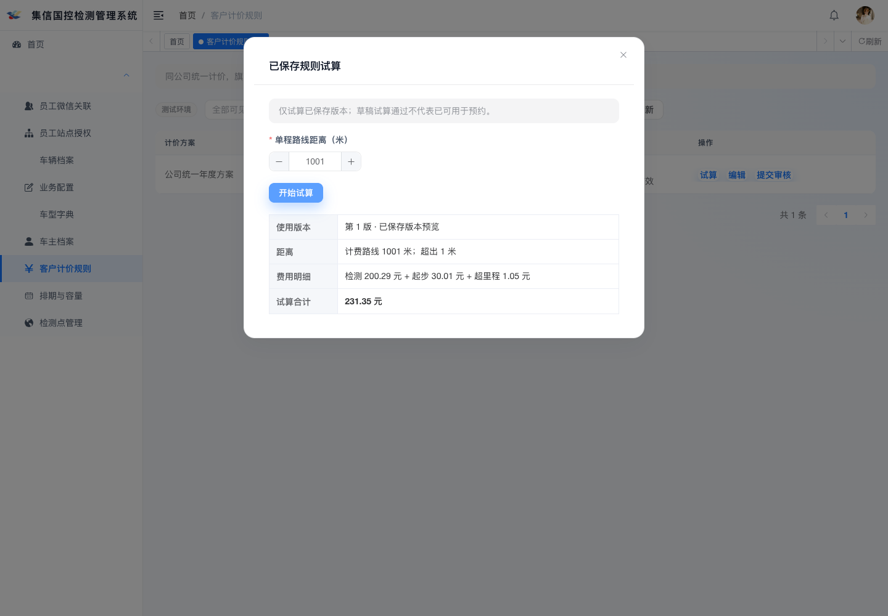

# C04 · 公司统一客户计价与试算

范围：V6.4-COMPANY-PRICING-20261101。实现与测试完成，账本标记VERIFIED；独立复核待办。

## 业务和权限

用户2026-11-01明确：同公司统一维护，多个站点共用；超里程按比例计算后四舍五入到分。公司为管理员明确选择的owner_dept_id，通过vi_station.dept_id和部门树匹配旗下站点，不从操作者主部门或创建人猜测归属。全部列表、版本试算、审核、发布及修改按对应功能权限的部门范围在Service校验；写入加载真实记录，空范围拒绝。公司、环境、车型/检测类型创建后固定，不能借修改ID或提交其他部门迁移记录。

新增9个实际API、后台B20/B20-edit/B20-review，入口`/rongli/pricing`。支持创建/编辑草稿、派生修订、提交、独立审核/驳回、发布、停用、保存版本试算及站点生效匹配试算。所有流程落真实MySQL；UI不会将本地试算当作发布。小程序正式报价由后续B02接入共享PricingService，本任务不创建空壳报价页面。

创建人、提交人及任一编辑参与人不得审核该版本。审核绑定公司、环境与完整规范化配置SHA-256；审核后的价格内容冻结，发布重验哈希。新修订保留旧配置，不追改历史订单。发布拒绝重叠区间及多匹配；立即替换须显式指定旧版ID+版本，在同一事务停用旧版、发布新版。未来版本使用相邻[start,end)排期，不得提前停用当前价格造成空窗。

金额全程整数分，往返先乘二再扣包含米；整单位向上进位、精确比例HALF_UP到分共用同一计算器。非法整数、负数、溢出、未配置、多匹配和TEST/LIVE混用均拒绝；等待费P02未批准，拒绝启用及非零参数。旧的仅按车型计数入口关闭，正式报价须有真实站点、车型、检测类型、时间和部署环境。

目录→公司→规则固定锁序；所有写操作的权限检查、CAS、幂等、业务、成功审计和outbox同事务。失败审计独立保留且不记录SQL/凭据。故障重试保持原请求、版本和幂等键。该功能不写用户授权关系或auth_version；权限撤销仍由现有框架统一授权流程处理，旧Token过滤链已回归验证，不依赖Redis删除。

## 已执行验证

- 完整17类HTTP/MySQL回归145/145，0失败、0错误、0跳过；其中C04PricingIT 14、C04LivePricingIT 1，C01ConfigIT 6；单元29/29。
- 覆盖跨公司/伪造归属/内部字段/空范围、创建及编辑人自审、审核冻结与篡改摘要、CAS/幂等、无匹配/多匹配、并发发布、TEST/LIVE隔离、HALF_UP边界和相邻排期。真实临时触发器使PRICE_PUBLISH发件箱写入失败，确认旧版本仍发布、新版仍批准、成功审计及outbox全部回滚、失败审计保留；仅在专属测试库注入并finally删除。
- PC生产构建、小程序类型检查与微信目标构建通过。工程一致性34/34、资料深度一致性42/42、契约回归18/18（含替换ID及版本必须成对）。
- Playwright实际操作Vue页面：阻止三位小数、元转整数分、故意503后的同意图幂等重试、试算分项和合计、提交原版本。1440×1000及390×844检查无空白、无错误覆盖层、无意外控制台或页面错误。UI接口为明确夹具，真实业务权限/事务以独立HTTP/MySQL回归为证；截图下附。微信真机未执行。

本轮首个合并回归因测试Python相对路径在模块工作目录下不存在而未启动C01，改为绝对路径后完整145项通过。UI脚本首次使用了错误语言的弹窗关闭按钮定位，修正后复跑通过；未改变业务期望。

[手机端表单截图](pricing-mobile.png) · [UI验证](ui-qa.json) · [完整回归](full-regression-20261101.json) · [脱敏JUnit](regression-junit-20261101.xml) · [迁移验证](schema-verification.json)

## SQL、发布与恢复

新增增量脚本`sql/migration_20261101_02_customer_pricing.sql`，同步`sql/ry_20260417.sql`及资料包`05_数据设计/001_vi业务表_初始化_V6.4.sql`。部署顺序：确认此前站点迁移`migration_20261101_station_contact_qualification.sql`已完成→单独备份vi_price_rule→本次增量执行一次→保存异常查询及结构校验结果→部署/重启后端、更新PC。已有库禁止重跑完整初始化，无需Redis清缓存。

新增7个可空列、1个复合索引、4个兼容NULL的CHECK；旧记录不猜测回填、不删除。缺权威公司/环境/审核绑定的旧规则不能参与新报价，需核实后新建并独立审核发布。

已在专属测试库xinyi_vi_it_e07实际执行增量，另建随机归属临时库验证“旧版表+增量”与“新版完整初始化”及当前测试库的21列、4索引、6约束一致，校验类型、顺序、默认值、排序规则、注释、索引及CHECK表达式。临时库旧记录保持原始数据与NULL隔离状态，未猜测回填；本轮临时库已按归属标记清理。现有xinyi业务库与生产均未变更。本机MySQL9.6，生产目标8.4仍须部署门禁复跑。

回退优先回退应用、保留新增列及完整审计，不直接删列。物理恢复须停写、独立归档新增数据后按审批恢复备份，详见增量脚本头部。

主PRD、页面规格、OpenAPI、操作索引、类型、模型、字段字典、写入白名单和任务输入已同步。当前总契约291操作、381结构、355画板、79表、412源验收；不能用局部145项回归替代全部源验收、独立复核或G01。

下一主线：B01候选时段与服务范围，再B02正式报价，接入本轮PricingService的唯一版本匹配和C03站点双额度；B03随后接续建单。真实支付/短信/订阅及生产部署均未执行。
